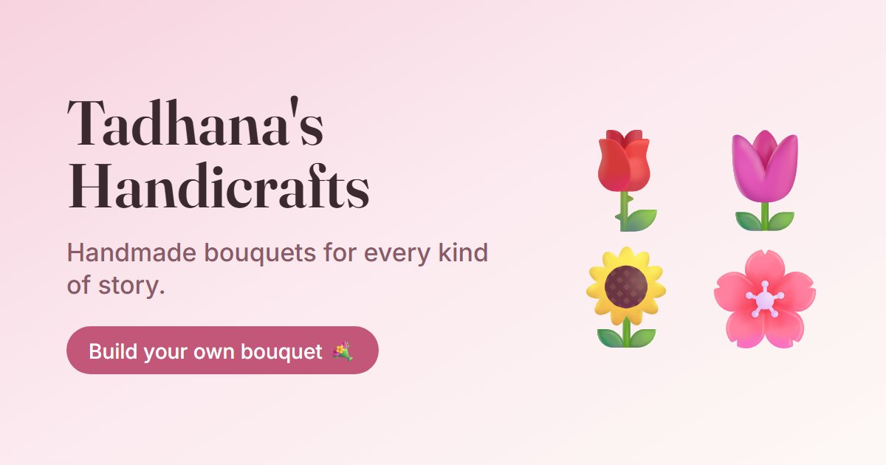

# 🌷 Tadhana's Handicrafts

<p align="center">
  
</p>

<p align="center">
  <strong>Handmade bouquets, ordered from your phone: browse, build your own, and send the receipt on Messenger.</strong><br />
  A phone-first flower shop website for Tadhana's Handicrafts. Customers browse the bouquets she has made, order one as
  it is or build their own stem by stem, and send a ready-made receipt to the shop's Facebook page. The owner manages
  everything (photos, flowers, stock, prices) from her own admin dashboard.
</p>

<p align="center">
  
  
  
  
  
  
  
</p>

<p align="center">
  🌐 <b>Live:</b> <a href="https://tadhanas-handicrafts.vercel.app">tadhanas-handicrafts.vercel.app</a>
  &nbsp;·&nbsp; 💐 <code>/#/</code> &nbsp;·&nbsp; ✏️ <code>/#/customize</code> &nbsp;·&nbsp; 🧾 <code>/#/receipt</code> &nbsp;·&nbsp; 🛠️ <code>/#/admin</code>
</p>

<p align="center">
  
</p>

---

## 📖 Table of Contents

- [Overview](#-overview)
- [System Architecture](#️-system-architecture)
- [Key Features](#-key-features)
  - [Bouquet Showcase](#-bouquet-showcase)
  - [Build Your Own Bouquet](#️-build-your-own-bouquet)
  - [Receipt & Messenger Ordering](#-receipt--messenger-ordering)
  - [Phone-First Experience](#-phone-first-experience)
  - [Handmade Craft Design & Animations](#-handmade-craft-design--animations)
  - [Admin Dashboard](#️-admin-dashboard)
  - [Sharing & Home Screen](#-sharing--home-screen)
- [Tech Stack](#️-tech-stack)
- [Database Schema](#️-database-schema)
- [Project Directory Structure](#-project-directory-structure)
- [Pages & Routes](#-pages--routes)
- [Installation & Getting Started](#-installation--getting-started)
- [Environment Configuration](#️-environment-configuration)
- [Deployment (Vercel & Supabase)](#-deployment-vercel--supabase)
- [Security & Privacy](#-security--privacy)
- [Documentation](#-documentation)

---

## 🌟 Overview

**Tadhana's Handicrafts** is a small, handmade flower business that takes its orders through Facebook Messenger. Before this site, every order meant a long back-and-forth chat: *which flowers, what colors, how many, which wrap, when do you need it?* This website does that part for the customer. Most customers shop from their phones, so it is built phone-first:

1. **Bouquet Showcase** (home page):
   The bouquets she has made, as polaroid photos with a code (`#B001`), price, and what's inside. Customers **order one as it is** or tap **Make one like this** to start from it.
2. **Build Your Own** (any phone browser):
   Pick flowers and fillers, colors and quantities, a wrap, extras and a card message. No prices for custom flowers; the shop quotes those.
3. **Receipt → Messenger**:
   Placing an order creates a receipt with an order number. On a phone, **Share receipt to Messenger** sends the receipt picture straight to the shop's page.
4. **Admin Dashboard + Supabase**:
   The owner signs in to manage photos, bouquets, flowers, stock, prices, wraps, extras and shop info. Changes show on the site right away.

---

## 🏗️ System Architecture

```
tadhanas-handicrafts/
├── src/pages/        # Home, Build your own, Receipt, Admin (dashboard + login)
├── src/components/   # Polaroid cards, seed-packet flower cards, order sheet, doodles, petals, …
├── src/lib/          # Shop data, cart, receipt text, prices, photo upload, animations helpers
├── src/styles/       # base (tokens), shop (craft look + motion), admin
├── supabase/         # schema.sql: tables, security rules, photo storage, starter data
├── public/           # App icons, link-preview image, web manifest
└── .github/          # Keep-awake ping for the free Supabase project
```

```
┌──────────────────────────────────┐        ┌───────────────────────────────────┐
│   Customer (phone browser)       │        │   Owner (phone / laptop)          │
│  • Browse bouquets, shuffle hero │        │  • /#/admin dashboard             │
│  • Build a bouquet, place order  │        │  • Photos, flowers, stock, prices │
│  • Receipt → Share to Messenger  │        │  • Shop info, home page photos    │
└────────────────┬─────────────────┘        └─────────────────┬─────────────────┘
                 │                 HTTPS                      │
                 └────────────────────┬───────────────────────┘
                                      │
                    ┌─────────────────▼────────────────┐
                    │   Vercel (static React app)      │
                    │  • Vite build, auto-deploy on    │
                    │    every git push                │
                    │  • Cart + receipt live on the    │
                    │    customer's phone              │
                    └─────────────────┬────────────────┘
                                      │  publishable key (read for all,
                                      │  write only when signed in)
                    ┌─────────────────▼────────────────┐      ┌─────────────────────┐
                    │  Supabase                        │      │  GitHub Actions     │
                    │  • PostgreSQL: 4 tables + RLS    │<─────│  Ping every 3 days  │
                    │  • Storage: bouquet photos       │      │  (keeps the free    │
                    │  • Auth: owner login only        │      │   project awake)    │
                    └──────────────────────────────────┘      └─────────────────────┘
                                      ┊
                    ┌─────────────────▼────────────────┐
                    │  Facebook Messenger              │
                    │  Customer sends the receipt;     │
                    │  the shop replies with the price │
                    └──────────────────────────────────┘
```

**How an order works:** the customer adds bouquets or flowers → the cart is saved on their phone → **Place order** checks their name and date and freezes the cart into a receipt (`TH-YYMMDD-XXXX`) → the receipt is turned into a picture right away → **Share receipt to Messenger** opens the phone's share menu with it attached → the shop replies on Messenger with the final price and payment details. No customer data is stored in the database.

---

## 🚀 Key Features

### 💐 Bouquet Showcase
- **Polaroid Gallery** — Each bouquet is a slightly tilted polaroid with washi tape, a hanging **code tag** (`#B001`) and a handwritten **₱ price** (prices are optional).
- **What's Inside** — The flowers, colors and amounts in each bouquet, with out-of-stock ones crossed out.
- **Make One Like This** — Loads that bouquet's flowers and wrap into the builder so the customer only changes what they want; the receipt says *Inspired by #B003*.
- **Shop by Occasion** — Round doodle tiles (Anniversary, Birthday, Graduation, Sympathy, …) that filter the gallery.
- **Photo Popup** — Tap a photo to see it full size with its details; on phones it's a sheet you can swipe down to close.
- **Shuffle the Hero** — The polaroid stack at the top shuffles like a deck of photos when tapped or swiped.

### ✏️ Build Your Own Bouquet
- **Seed-Packet Flower Cards** — Every flower and filler with its photo, **round color swatches** and a **+ / −** counter.
- **Wrap, Extras & Card Message** — One wrap, any extras (card, ribbon, chocolates), and a note for the card.
- **Out-of-Stock Safe** — If the owner marks something out of stock, returning customers' saved orders drop it with a friendly note.
- **No Price Guessing** — Custom flowers are marked *TBC* and quoted by the shop; ready-made bouquets show their price and a subtotal.

### 🧾 Receipt & Messenger Ordering
- **Required Details** — Name, pickup or delivery, and a date that isn't in the past; the order won't go through without them.
- **Order Slip** — Order number, every item and quantity, codes, prices / TBC, wrap, extras, card message and customer details, with an **"Order placed" stamp**.
- **One-Tap Share** — On phones, **Share receipt to Messenger** attaches the receipt picture through the phone's share menu.
- **Fallbacks** — Save the receipt as an image (laptops), press-and-hold to save (older phones), or copy the order as text.

### 📱 Phone-First Experience
- **App-Like Layout** — Bottom tab bar (Bouquets · Build · My order) with a live count, 2-column grids, and bottom sheets you can swipe down.
- **Instant Loading** — The last-seen shop is remembered on the phone, so refreshes show the real bouquets immediately while it quietly updates; first visits show soft loading placeholders.
- **Light on Data** — Cards load small photo copies (about 40 KB); the full photo loads only when zoomed.
- **Comfortable to Use** — 44 px tap targets, no zoom-on-tap for inputs on iPhone, and spacing for the notch and home bar.

### ✨ Handmade Craft Design & Animations
- **Warm Craft Look** — Cream paper texture, kraft panels, dusty rose and sage, a handwritten accent font, and hand-drawn doodles instead of icons.
- **Hero Entrance** — Words rise in one by one, the underline draws itself, polaroids drop in and sway, and petals drift down.
- **Fly to My Order** — Tapping *Order this* or *+ Add* flies a little photo bubble into the order button.
- **Small Delights** — Cascading card reveals, a drawn How-it-works timeline, wiggling occasion icons and a petal shower on the receipt.
- **Kind to Phones** — Only transform/opacity animations, fewer petals on phones, and everything stays still for people who prefer reduced motion.

### 🛠️ Admin Dashboard
- **Overview** — Counts at a glance and a **Needs attention** list: out-of-stock items (restock in one tap), bouquets without photos, empty *What's inside* lists, and the Messenger username.
- **Bouquets, Flowers, Fillers, Wraps & Extras** — Searchable photo cards with an **In stock / Out of stock** switch, a side-panel editor, and reorder or delete from a **⋯** menu.
- **Bouquet Details** — Photo, name, **price**, category, description, **What's inside** editor and wrap; codes are auto-numbered (`B001`, `B002`, …).
- **Photos** — Upload from the phone; pictures are shrunk automatically and saved with a small thumbnail copy.
- **Shop Info** — Shop name, tagline, Messenger username (with a **Test link** button), Facebook, phone, location, hours, **home page photos** and an **About the maker** story.
- **Clear Errors** — Problems show in plain words right above the Save button (e.g. *"Your database is missing the new price field…"*).
- **Test Mode** — Without Supabase keys the whole site and admin run on sample data saved in the browser, for trying things out.

### 🔗 Sharing & Home Screen
- **Link Preview** — Sharing the link on Facebook or Messenger shows a designed preview card with the shop name and flowers.
- **Add to Home Screen** — Tulip app icon and web manifest, so regular customers and the owner can open it like an app.

---

## 🛠️ Tech Stack

*Exact versions installed in the project (October 2026).*

### Application
| Package | Version | Purpose |
|---------|---------|---------|
| **React / React DOM** | 19.3.0 | User interface |
| **@supabase/supabase-js** | 2.117.2 | Database, photo storage and owner login |
| **html-to-image** | 1.11.13 | Turning the receipt into a shareable picture |
| **Google Fonts** | — | Fraunces (headings), Nunito (body), Caveat (handwritten accents) |

No UI or animation libraries: the craft look, doodles and animations are plain CSS, inline SVG and the Web Animations API.

### Development
| Tool | Version | Purpose |
|------|---------|---------|
| **Vite** | 8.3.1 | Dev server and production build |
| **@vitejs/plugin-react** | 6.1.1 | React support for Vite |
| **Node.js** | 20.19+ or 22.12+ | Runtime (required by Vite 8) |

### Services
| Service | Used for |
|---------|----------|
| **Vercel** | Hosting, HTTPS, auto-deploy on every push |
| **Supabase** | PostgreSQL, row-level security, photo storage, owner login (free plan) |
| **GitHub** | Source code; Actions run the keep-awake ping |
| **Facebook Messenger** | Where customers send their receipts and the shop replies |

---

## 🗄️ Database Schema

The shop runs on **Supabase PostgreSQL** with row-level security on every table. Orders are **not** stored: they travel as receipts on Messenger.

| Table | What it holds |
|-------|---------------|
| `settings` | One row: shop name, tagline, Messenger username, Facebook link, phone, location, hours, `about_title` / `about_text` / `about_photo`, `hero_photos` (JSON) |
| `bouquets` | `code`, name, category, description, `price`, photo, emoji, `wrapper_id`, `recipe` (JSON: flower, color, qty), sort order, `active` |
| `flowers` | Name, `type` (`main` or `filler`), `colors` (text array), photo, emoji, sort order, `active` (in stock) |
| `options` | `kind` (`wrapper` or `addon`), name, sort order, `active` |

**Storage:** a public `photos` bucket. Each upload is saved as `name.jpg` (up to 1400 px) plus `name.thumb.jpg` (480 px) for cards.

> **Setting up a new database?** Run [`supabase/schema.sql`](supabase/schema.sql) once in the Supabase SQL editor. It creates the tables, security rules, photo storage and starter data, and is safe to run again after updates.

---

## 📁 Project Directory Structure

```
tadhanas-handicrafts/
├── index.html                      # Fonts, link-preview tags, icons
├── src/
│   ├── main.jsx                    # Entry: loads base + shop styles
│   ├── App.jsx                     # Hash routes, page fade, lazy-loaded admin
│   ├── pages/
│   │   ├── Home.jsx                # Hero, occasions, gallery, how it works, about
│   │   ├── Customize.jsx           # Build your own bouquet
│   │   ├── Receipt.jsx             # Order slip, stamp, share / save / copy
│   │   └── admin/
│   │       ├── Admin.jsx           # Dashboard layout + sections
│   │       ├── Overview.jsx        # Counts + "Needs attention"
│   │       ├── CrudTable.jsx       # Photo cards, filters, side-panel editor
│   │       ├── RecipeEditor.jsx    # "What's inside" + wrap
│   │       ├── SettingsForm.jsx    # Shop info, home page photos, about
│   │       └── Login.jsx           # Owner sign-in
│   ├── components/
│   │   ├── home/                   # HeroCollage, OccasionTiles, HowItWorks, AboutMaker
│   │   ├── BouquetCard.jsx         # Polaroid bouquet card
│   │   ├── FlowerCard.jsx          # Seed-packet flower card with swatches
│   │   ├── CartPanel.jsx           # Order slip / swipeable bottom sheet
│   │   ├── Doodle.jsx              # Hand-drawn SVG doodles
│   │   └── Petals.jsx              # Falling petals
│   ├── lib/
│   │   ├── db.js                   # Supabase or test-mode data, photo upload
│   │   ├── shopData.jsx            # Shop data + instant-load cache
│   │   ├── cart.jsx                # Cart, stock check, place order
│   │   ├── order.js                # Receipt text, Messenger link
│   │   ├── pricing.js / money.js   # Bouquet subtotals, ₱ formatting
│   │   ├── flyToCart.js            # "Fly to my order" animation
│   │   └── useSwipeDown.js         # Swipe-down-to-close sheets
│   ├── styles/                     # base.css, shop.css, admin.css
│   └── data/shop.js                # Sample data for test mode and first setup
├── supabase/schema.sql             # Tables, RLS, storage, starter data
├── public/                         # Icons, og-image.jpg, manifest.webmanifest
├── .github/workflows/              # keep-supabase-awake.yml
├── vercel.json                     # Build settings + asset caching
└── vite.config.js                  # Fills in the site address for link previews
```

---

## 🧭 Pages & Routes

The site is a single-page app with hash routes, so it works on any static host without extra rewrite rules.

| Route | Who | Description |
|-------|-----|-------------|
| `/#/` | Customers | Hero, shop by occasion, bouquet gallery, how ordering works, about the maker |
| `/#/customize` | Customers | Build your own bouquet; the order panel (sheet on phones) |
| `/#/customize/bag` | Customers | Same page with the order sheet opened (the **My order** tab) |
| `/#/receipt` | Customers | The latest order's receipt with share, save and copy |
| `/#/admin` | Owner | Sign-in, then the dashboard |
| `/#/admin/{section}` | Owner | `overview`, `bouquets`, `flowers`, `fillers`, `wraps`, `extras`, `settings` |
| `/#/admin/{section}/new` | Owner | Opens the "add new" editor directly |

---

## 📦 Installation & Getting Started

### Prerequisites

- [Node.js](https://nodejs.org/) 20.19+ or 22.12+
- A free [Supabase](https://supabase.com/) project (optional for local testing)

### 1. Clone the Repository

```bash
git clone https://github.com/KaisuS12/tadhanas-handicrafts.git
cd tadhanas-handicrafts
npm install
```

### 2. Try It in Test Mode (no setup)

```bash
npm run dev                     # http://localhost:5173
```

Without Supabase keys, the site and the admin (`/#/admin`, no login) run on sample data saved in your browser. **Reset test data** in the admin puts the samples back.

### 3. Connect Supabase

1. In the Supabase dashboard → **SQL Editor**, run [`supabase/schema.sql`](supabase/schema.sql).
2. **Authentication → Users → Add user**: create the owner's email and password (tick *Auto Confirm User*).
3. **Authentication → Sign In / Providers**: turn **off** *Allow new users to sign up*.
4. Copy `.env.example` to `.env` and fill it in (see below), then restart `npm run dev`.

### Useful Scripts

```bash
npm run dev          # Local dev server
npm run build        # Production build into dist/
npm run preview      # Preview the production build
```

---

## ⚙️ Environment Configuration

### **`.env`**
```env
# Supabase → Project Settings → API Keys
VITE_SUPABASE_URL=https://your-project.supabase.co
VITE_SUPABASE_ANON_KEY=sb_publishable_your-key      # the publishable / anon key, never the secret key

# Optional: your own domain, for the Facebook link preview
# (Vercel's address is filled in automatically)
# SITE_URL=https://www.your-domain.com
```

> Both `VITE_` values are **meant to be public**: they are built into the website. The data is protected by Supabase's row-level security, not by hiding these keys.

---

## 🚀 Deployment (Vercel & Supabase)

| Setting | Value |
|---------|-------|
| Hosting | Vercel: import the GitHub repo; the framework is detected as **Vite** |
| Build | `npm run build` → `dist/` (from `vercel.json`) |
| Updates | every `git push` to `main` deploys automatically |
| Environment | `VITE_SUPABASE_URL` and `VITE_SUPABASE_ANON_KEY` in Vercel → Settings → Environment Variables, type **Config** (not *Secret*), all environments, then **Redeploy** |
| Database changes | run the new lines of `supabase/schema.sql` in the SQL editor **before** pushing code that uses them |

### Keep-Awake Ping

Free Supabase projects pause after 7 days without activity. `.github/workflows/keep-supabase-awake.yml` pings the database every 3 days. Add two repository secrets (GitHub → Settings → Secrets and variables → Actions):

| Secret | Value |
|--------|-------|
| `SUPABASE_URL` | Same as `VITE_SUPABASE_URL` |
| `SUPABASE_ANON_KEY` | Same as `VITE_SUPABASE_ANON_KEY` |

Then run **Actions → Keep Supabase awake → Run workflow** once to check it. GitHub turns scheduled workflows off after 60 days without commits; click **Enable** on the Actions tab if that happens.

> **Phone sharing needs HTTPS.** *Share receipt to Messenger* works on the Vercel link; on a plain `http://` address phones get a "press and hold to save" screen instead.

---

## 🔒 Security & Privacy

- **Row-Level Security** — Anyone can **read** the shop (bouquets, flowers, options, settings); only a **signed-in** user can add, change or delete anything, or upload photos.
- **Owner-Only Login** — Public sign-ups are turned off, so the only account is the one created in the Supabase dashboard.
- **Only the Publishable Key in the Browser** — The secret / service-role key is never used by the site.
- **No Customer Database** — Orders aren't stored on a server. A customer's cart, details and receipt stay on **their own phone** until they send the receipt on Messenger.
- **Photos Are Public** — Everything uploaded to the `photos` bucket is meant to be seen on the site.
- **Secrets** — `.env` is git-ignored; on Vercel and GitHub the values live in environment variables and repository secrets.

**Known limitation:** prices on the site are a guide. Custom bouquets are always quoted on Messenger, and the shop confirms the final price there.

---

## 📚 Documentation

| Document | Contents |
|----------|----------|
| [supabase/schema.sql](supabase/schema.sql) | Every table, security rule and storage policy, with comments, plus starter data |
| [src/data/shop.js](src/data/shop.js) | Sample shop used in test mode and as the starting data |
| [Live site](https://tadhanas-handicrafts.vercel.app) | The shop as customers see it |

---

© 2026 **Tadhana's Handicrafts** · made with care so every bouquet order starts with a few taps instead of a long chat. Built by [@KaisuS12](https://github.com/KaisuS12).
